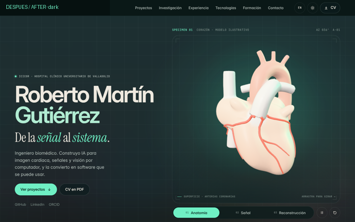
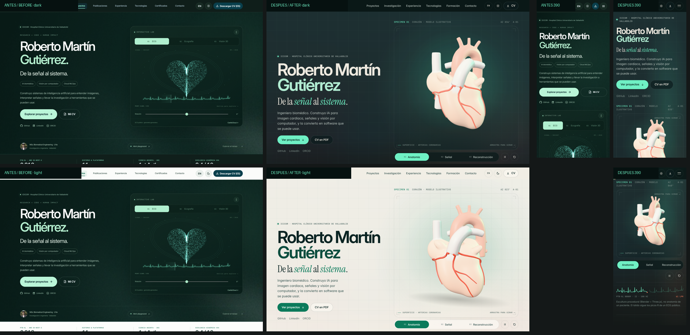

# Roberto Martín Gutiérrez — Biomedical AI, Computer Vision & Software

[](https://convderover.github.io/)
[](https://convderover.github.io/?lang=en)
[](https://orcid.org/0009-0004-5724-3502)

Bilingual (**Spanish / English**) portfolio of **Roberto Martín Gutiérrez** — Biomedical Engineer (MSc, University of Valladolid) and Research Engineer in Healthcare AI & Computational Cardiology (**ICICOR · Hospital Clínico Universitario de Valladolid**).



## Live URLs

- Portfolio (ES): https://convderover.github.io/
- Portfolio (EN): https://convderover.github.io/?lang=en
- CardioCloud case study (`v2-public`): https://convderover.github.io/cardiocloud/

## v3 · "Specimen lab" (November 2026)

A contemporary biomedical laboratory: petrol night and ivory paper themes, phosphor emerald for measurement, arterial coral for signal. Inter, Instrument Serif and JetBrains Mono are self-hosted (SIL OFL).

- **Specimen 01 (hero):** an illustrative procedural heart in three representations — *Anatomy* (porcelain surface, coronary arteries), *Signal* (glass shell, chambers and an illustrative SA → AV → His → Purkinje pulse) and *Reconstruction* (contour slices, surface point cloud and a scan sweep). Drag or arrow keys rotate it; vertical scrolling stays native on touch (`touch-action: pan-y`). Pause, reset, keyboard-operable mode switch. The beat follows the R-peaks of the public PTB-XL record 00009 (lead II, 100 Hz), shown unaltered in the strip below.
- **Case rooms:** CardioCloud (signal → model → review, with the documented 0.918 Macro AUROC and per-class values), ECOCARDIA (image → processing → review, illustrative echo without patient data) and Convity (code ↔ control-flow graph linked in both directions). Eight more projects as archive plates; every case opens a full record with previous/next navigation.
- **Research, experience, stack, education, contact:** editorial preprint with figure and copyable DOI, clinical-trial and grant ledger, chronology ruler, technology chips that list the real projects or roles using them, verifiable credentials, and a closing contact block.
- **After hours:** type `lab` (or use the footer) for the playground (orbits, heart, signal, scanner, pose). Discoveries: tap the 3D heart in rhythm (sets the beat — works on phones), tap the portrait three times (Sobel edges + Harris corners computed in the browser), type `ecg` (monitor mode).



A short walkthrough recording is in [`docs/portfolio-v3-walkthrough.mp4`](docs/portfolio-v3-walkthrough.mp4) (captured headless with software WebGL, so motion is slower than on a GPU).

## Architecture

Static HTML/CSS/JS served directly by GitHub Pages. **No build step is needed to deploy**: the only bundled file (`assets/js/hero3d.js`) is committed.

| File | Role |
| --- | --- |
| `index.html` | Semantic structure; static text carries `data-i18n` keys |
| `site.css` | Design system, both themes, all sections |
| `data.js` | Original bilingual records (projects, results, links) — the single source for facts |
| `design-data.js` | Short interface copy, project glyphs, credits |
| `app.js` | Language, theme, navigation, search/filters, cases, dialogs, stack ↔ project links |
| `lab.js` | Specimen bootstrap (lazy 3D, posters, ECG strip), case demos, playground, discoveries |
| `src/hero/heart.js` | Three.js r187 scene (source of `assets/js/hero3d.js`) |
| `cardiocloud/v3.css` | Visual bridge for the CardioCloud page; its evidence is unchanged |

### 3D asset pipeline

1. `tools/blender/build_heart.py` — Blender 5.3 (`bpy`) script: metaball myocardium with carved grooves, bevelled-curve great vessels, voxel-remesh union, Laplacian smoothing, decimation, region weights as vertex colours, BVH-snapped coronary tubes, internal chambers, conduction paths as node extras. Exports `assets/models/heart-source.glb`.
2. `npm run build:model` — glTF-Transform: weld, reorder, quantize, **meshopt** → `assets/models/heart.glb` (987 KB → 216 KB).
3. `npm run build` — esbuild bundles three.js (WebGLRenderer, GLTFLoader, meshopt decoder, RoomEnvironment, MeshSurfaceSampler) into `assets/js/hero3d.js` (≈672 KB, ≈174 KB gzip), loaded lazily after first paint.
4. `node tools/render-poster.cjs` (with the local server running) renders the poster images from the live scene (`assets/img/heart-*.webp`). They are the first frame, the loading state and the no-WebGL fallback for all three modes.

```bash
npm install                    # dev tools only (three, esbuild, glTF-Transform, fonts)
python3 -m venv .venv && .venv/bin/pip install bpy==5.3.0
.venv/bin/python tools/blender/build_heart.py --out assets/models/heart-source.glb
npm run build:model && npm run build
npm run serve                  # http://127.0.0.1:8090
```

### Performance & accessibility

- One WebGL context. Rendering stops off screen, in hidden tabs and when paused; geometries, materials and textures are disposed on teardown. DPR is capped (1.5 touch / 2 desktop) and lowered automatically if frames are slow. Reconstruction geometry and shaders are prepared lazily / in idle time.
- Motion (MIT, self-hosted) loads after `load`; each animated property has one owner (Motion: DOM entries and control thumbs; three.js loop: camera, materials, beat; CSS: poster/canvas cross-fade).
- `prefers-reduced-motion`: static 3D frame, no auto-rotation, no entry animations.
- Lighthouse (mobile profile, measured in a GPU-less container): **84** performance with the 3D replaced by its poster (FCP 1.7 s, LCP 4.1 s, TBT 170 ms, CLS 0); **50** with WebGL emulated on the CPU (SwiftShader), where GPU work counts as main-thread time. Accessibility 100, best practices 100, SEO 100. Real-device figures on a GPU are expected to sit between both and remain to be measured.

## Data honesty

The heart is an illustrative sculpture, labelled as such; it is not patient anatomy. Echo, pose and particle visuals are illustrative and run no inference. Scientific values (0.918 Macro AUROC, per-class AUROC, preprint figures, trial IDs, grades) are reproduced from the existing sources in `data.js`, `cardiocloud/README.md` and `cardiocloud/evidence/`.

## Credits

three.js (MIT) · Motion 14.12.0 ([MIT](assets/vendor/MOTION-LICENSE.md)) · Inter, Instrument Serif, JetBrains Mono ([OFL](assets/fonts/)) · Grainient Freebies as low-frequency decorative texture ([attribution and license](assets/img/GRAINIENT-ATTRIBUTION.md); previews only, not high-resolution originals) · PTB-XL v1.0.3 (Wagner et al., PhysioNet, CC BY 4.0). No MetalForge code is included. No Tripo-generated model is included.

### Tripo

`tripo-cli` 0.11.2 was installed and checked with `tripo doctor`, and API access was enabled, but no generation was run: the decision was not to spend credits. The heart is entirely procedural (Blender script in this repository). If a Tripo asset is ever wanted, it can go through the same Blender/glTF-Transform steps and replace `assets/models/heart.glb`.
