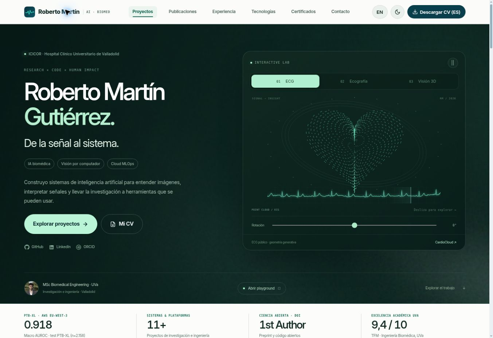

# Roberto Martín Gutiérrez — Biomedical AI, Computer Vision & Cloud MLOps Portfolio

[](https://convderover.github.io/)
[](https://convderover.github.io/?lang=en)
[](https://orcid.org/0009-0004-5724-3502)

Bilingual (**Spanish / English**) engineering and research portfolio of **Roberto Martín Gutiérrez** — Biomedical Engineer (MSc, University of Valladolid) and Research Engineer in Healthcare AI & Computational Cardiology (**ICICOR · Hospital Clínico Universitario de Valladolid**).

## Live URLs

- **Portfolio (Español):** https://convderover.github.io/
- **Portfolio (English):** https://convderover.github.io/?lang=en
- **CardioCloud AWS Engineering Case Study (`v2-public`):** https://convderover.github.io/cardiocloud/

## Technical Highlights

- **Static architecture with self-hosted Motion:** Semantic HTML5, modern CSS (`color-scheme: light dark`, `light-dark()`, `scroll-target-group: auto`, `interpolate-size: allow-keywords`, View Transitions with `view-transition-class`, top-layer `<dialog closedby="any">`, `@media print`), and vanilla JavaScript.
- **Privacy & self-hosted assets:** Self-hosted `Inter-Variable.woff2` typography, zero third-party trackers or external CDNs, and phone-redacted downloadable CVs (`ES` / `EN` PDF).
- **Audited public case studies:** Includes the allowlisted public edition of **CardioCloud** (PyTorch 12-lead ECG classification on PTB-XL with `0.918` Macro AUROC, Terraform IaC on AWS `eu-west-3`, *Validate before display* Bedrock safeguards, persisted DynamoDB human review, 25s 1080p product cut, and 6-page PDF monograph).

## Local Preview

```bash
python -m http.server 8090 --bind 127.0.0.1
```

Then open `http://127.0.0.1:8090` in any modern browser.

## Interactive laboratory (November 2026)

The portfolio adds a concise editorial layer (`design-data.js`) while retaining the detailed project records in `data.js`. `lab.js` provides a WebGL point cloud with a Canvas fallback, illustrative echo and pose scenes, the public ECG signal explorer, an ECOCARDIA architecture walkthrough, and a static Convity before/after example. These visual demos do not run clinical inference or connect to hospital systems or AWS.

All sections use progressive disclosure. Project search combines with domain filters. The optional particle playground is available from the hero; typing `LAB` outside a text field opens it, and tapping the brand mark five times reveals a pulse. ES/EN, both CVs, original galleries, native dialogs and theme switching remain available.

Animations use [Motion 14.12.0](https://motion.dev/) bundled locally under its [MIT license](assets/vendor/MOTION-LICENSE.md). Decorative Grainient Freebies textures are blended into the site; see [source and license notes](assets/img/GRAINIENT-ATTRIBUTION.md). No MetalForge source is included.

Canvas rendering pauses off screen, in a background tab or via the pause controls. Reduced-motion preferences disable continuous animation and entry transitions. DPR is capped and scenes share one 30 fps scheduler. CardioCloud retains its evidence and adds local signal-gain controls, collapsible architecture layers and a return link.


